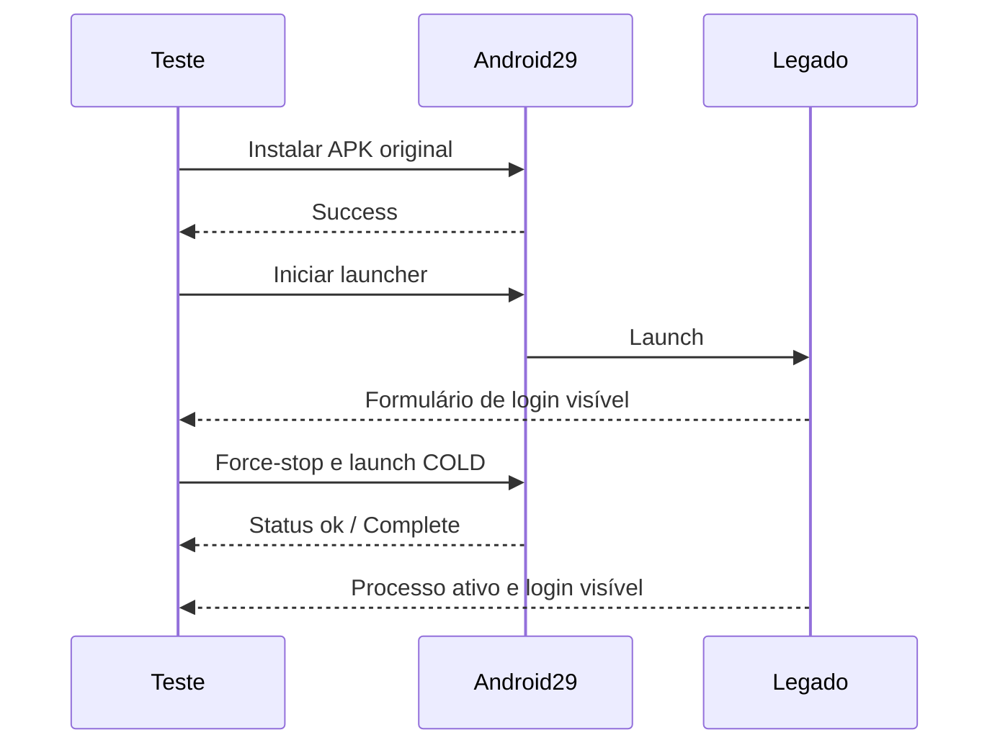

# Brasil TV runtime analysis
## Estado atual — 2026-10-20

**RUNTIME_UNBLOCKED na API 29 x86.** APK original instalado do zero, login visível,
processo estável entre observações e segundo launch COLD com Status ok/Complete.
Ver [matriz](brasil-tv-compatibility-matrix.md) e [causa provável](brasil-tv-startup-crash.md).
O Android mostrou solicitação de acesso à mídia; ela foi concedida somente no
AVD vazio de pesquisa. A tela seguinte tem campo de usuário vazio, campo de senha
vazio/mascarado e botão CONECTAR. Nenhuma credencial foi submetida.

Auth path: UI alcançada, CONFIRMED. Chamadas CAuth, config/bootstrap, device JNI,
broker, resource e protocolo de catálogo: UNKNOWN; não instrumentados ainda.
Catálogo e dois canais não observados por falta de sessão de teste.
Bibliotecas carregadas: UNKNOWN. ADB root foi recusado pela imagem de produção;
nenhuma proteção foi alterada para obter acesso. Nomes estáticos não são prova de load.
Socket local: NOT_OBSERVED; isso não prova ausência de gateway.

Sequência sustentada por esta execução:

Nenhuma seta de rede/auth/broker está confirmada por esse diagrama.
`scripts/observe-legacy-startup.ps1` emite timestamp/component/method/event/
argument_types/result_type e somente booleanos de presença. É observação de
UI/processo, não instrumentação de CAuth ou TVCore.

Bloqueio ativo: **BLOCKED_BY_PROVIDER_INFORMATION**, conta/sessão de teste ainda
não disponibilizada. O histórico abaixo descreve o ambiente API 34 e não substitui
o resultado atual na API 29.

## Histórico API 34
## Environment
AVD dedicado provider52, Android TV API 34 x86, porta ADB 5556;
sem conta de terceiro, separado do AVD IA TV. APK x86 disponível.
Em 18/09, sys.boot_completed retornou 1. adb install foi iniciado,
mas não retornou confirmação durante a execução observada.
Em 21/09 o emulador estava parado e foi reiniciado. Resultado final abaixo.
## App Startup
Em 21/09, instalação --no-streaming concluída com Success após aprovação explícita do usuário para Install anyway no AVD isolado. Play Protect havia bloqueado por target antigo. am start aceitou o launcher, mas o app falhou repetidamente em onCreate. Marcadores sanitizados: java.lang.ClassCastException, java.lang.Long cannot be cast to java.lang.Integer, org.sopcast.android.SopCast.onCreate(MyApplication:18). Processo encerrado com force-stop para interromper o loop. Não houve login, catálogo ou frame observado.
## Authentication
UNKNOWN. Conta de teste/sessão não fornecida. Autorização para análise não equivale a credencial.
## Configuration
UNKNOWN.
## Live Catalog
UNKNOWN; nenhum catálogo confirmado.
## Channel Resource
UNKNOWN; duas seleções ainda não observadas.
## TVCore
Somente símbolos estáticos confirmados; sequência de chamadas não observada.
## Broker
Payload, resposta e dependência de sessão UNKNOWN.
## Local Gateway
UNKNOWN; nenhuma correlação entre processo, porta e URI.
## Final Playback URL
UNKNOWN. Não persistir URLs assinadas nem identificadores em paths.
## Video Format
UNKNOWN; MIME/manifesto real não observado.
## Device Identity
UNKNOWN em execução; campos estáticos documentados.
## Entitlement
UNKNOWN; nenhum VIP/plan/trial/limite inferido.
## VOD
Não executado.
## Series
Não executado.
## Confirmed Findings
Emulador dedicado iniciou, APK instalou e launcher foi chamado em 21/09; crash de inicialização confirmado. Não há seta do fluxo
do aplicativo suficientemente observada para publicar um diagrama como confirmado.
## Remaining Unknowns
Auth, catálogo, resource, broker, URI, formato, binding, expiração e VOD.
## Procedimento de retomada
1. Confirmar instalação, abrir org.sopcast.android.SopCast.
2. Login normal com conta de teste, mantida fora do Git.
3. Registrar sequência estrutural de auth/config/catalog, sem valores.
4. Selecionar dois canais; correlacionar ID/resource/TVCore/porta/URI.
5. Repetir sessão e relaunch sem forjar/reutilizar tokens.
6. Depois de contratos suficientes: live 10 minutos com TTFF/buffering/erros,
   filme com seek/retomada e episódio com progresso/próximo.
Helper safeShape remove valores antes da persistência; não é um probe JNI já instalado.
Não salvar logcat bruto, HAR, PCAP ou memória como relatório.

## Bloqueio confirmado em 21/09
BLOCKED_BY_RUNTIME_ENVIRONMENT: incompatibilidade de inicialização nesta imagem API 34 x86. Precisamos de imagem/dispositivo compatível (testar Android 10/API 29 primeiro) ou build corrigido do legado. SDK local só possui imagens 36.1/37.1 além da imagem 34 de pesquisa; cmdline-tools ausente. Não corrigir o cast por patch binário sem compreender o comportamento. BLOCKED_BY_PROVIDER_INFORMATION também permanece: sessão de teste/contrato não recebido.
